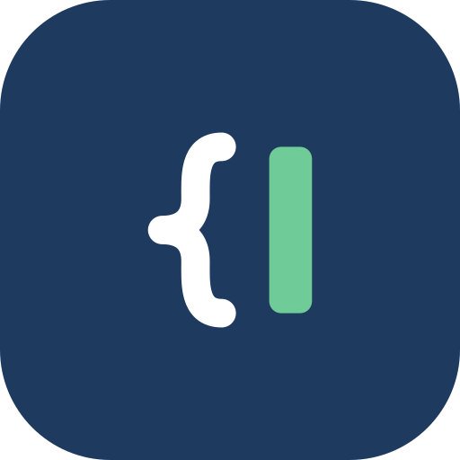
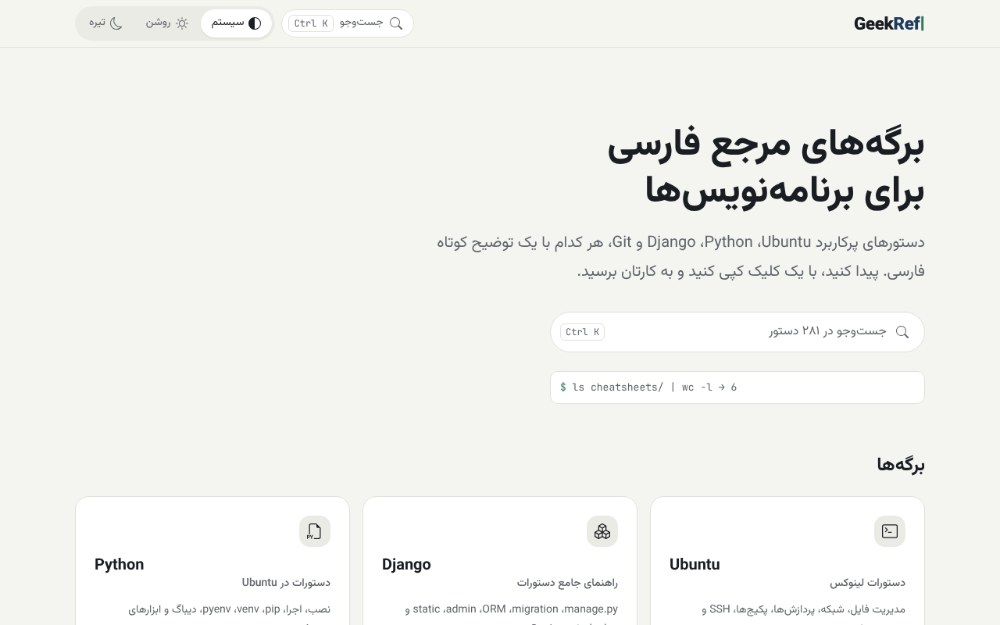
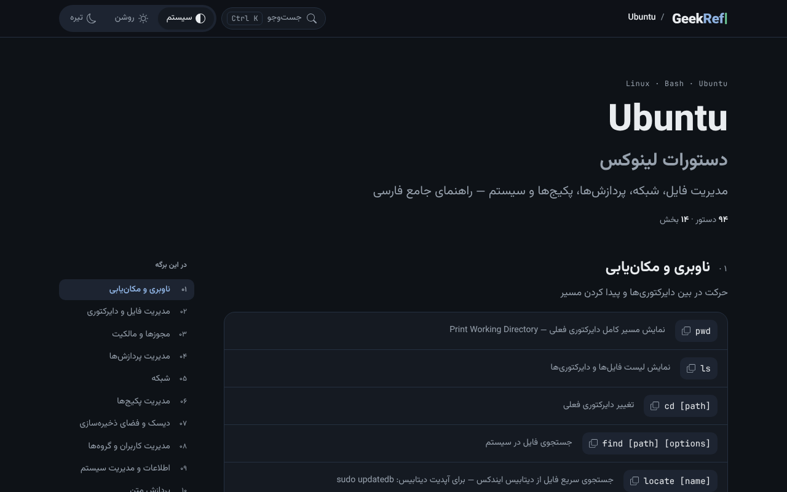

<p align="center">
  
</p>

<h1 align="center">GeekRef</h1>

<p align="center" dir="rtl">برگه‌های مرجع فارسی برای برنامه‌نویس‌ها: دستورهای پرکاربرد، هر کدام با یک توضیح کوتاه فارسی.</p>
<p align="center">Persian quick-reference sheets for developers: common commands, each with a short Persian description.</p>

<p align="center"><a href="https://mani-imani.github.io/GeekRef/"><b>mani-imani.github.io/GeekRef</b></a></p>
<p align="center"><a href="#فارسی">فارسی</a> · <a href="#english">English</a> · <code>v2.2.0</code></p>

---

<div dir="rtl">

## فارسی

### چه کاری می‌کند

GeekRef مجموعه‌ای از برگه‌های مرجع است: دستورهای پرکاربرد، هر کدام با یک توضیح کوتاه فارسی. دستور را پیدا می‌کنید، با یک کلیک کپی می‌کنید و به کارتان برمی‌گردید.

| برگه | دستور | موضوع |
|---|---|---|
| Ubuntu | ۹۴ | فایل‌ها، مجوزها، پردازش‌ها، شبکه، بسته‌ها، SSH |
| Django | ۴۵ | ساخت پروژه، migration، ORM، پنل مدیریت، استقرار |
| Python | ۵۵ | نصب، اجرا، pip، venv، pyenv، دیباگ |
| Python Setup | ۳۴ | آماده کردن محیط توسعه، گام به گام |
| Git | ۲۷ | تنظیم، کار محلی، شاخه‌ها، مخزن راه دور، بازگردانی |
| tree | ۲۷ | نمایش درختی پوشه‌ها، فیلتر و خروجی |

### چرا

بیشتر مرجع‌ها انگلیسی‌اند و برای یک دستور ساده باید چند صفحه را گشت. این برگه‌ها را اول برای کار خودم نوشتم: کوتاه، فارسی و همیشه دم دست.

### ویژگی‌ها

- جست‌وجو در همه‌ی برگه‌ها با <kbd>/</kbd> یا <kbd>Ctrl</kbd> + <kbd>K</kbd> (در مک <kbd>⌘</kbd> + <kbd>K</kbd>)، با جابه‌جایی میان نتیجه‌ها با کلیدهای جهت‌نما
- هر نتیجه‌ی جست‌وجو مستقیم به همان دستور می‌رود و آن را مشخص می‌کند
- نتیجه‌ها مرتب‌اند: دستوری که با واژه‌ی شما شروع می‌شود اول می‌آید و برگه‌ای که در آن هستید جلوتر است؛ رقم فارسی و انگلیسی و نیم‌فاصله فرقی نمی‌کنند
- هر دستور پیوند اختصاصی دارد؛ دکمه‌ی پیوند کنار هر ردیف آن را کپی می‌کند تا برای کسی بفرستید
- کپی هر دستور با یک کلیک یا با <kbd>Enter</kbd>، در همه‌ی برگه‌ها از جمله کارت‌های <bdi>Git</bdi>
- بعد از اولین بازدید، بدون اینترنت هم کار می‌کند و می‌شود آن را مثل یک برنامه نصب کرد؛ در اولین بازدید یک کارت کوچک نصب را پیشنهاد می‌دهد (در <bdi>iPhone</bdi> و <bdi>iPad</bdi> دو قدمِ <bdi>Safari</bdi> را نشان می‌دهد) و پیوند «نصب به‌شکل برنامه» همیشه پایین صفحه هست
- پوسته‌ی روشن و تیره، با پیش‌فرض پیروی از سیستم
- فهرست هر برگه در کنار صفحه، و روی موبایل به‌شکل فهرست تاشو
- کار با صفحه‌کلید، کنتراست استاندارد و نسخه‌ی چاپی تمیز
- بدون فریم‌ورک؛ فونت‌ها محلی‌اند و چیزی از CDN بار نمی‌شود

### نمای سایت

<p align="center">
  <br><br>
  
</p>

### اجرا روی سیستم خودتان

جست‌وجو فایل <code dir="ltr">search-index.json</code> را می‌خواند و حالت بدون اینترنت به سرور نیاز دارد؛ مرورگر هیچ‌کدام را از روی <code dir="ltr">file&#58;//</code> اجازه نمی‌دهد. پس سایت را با یک سرور ساده باز کنید:

<div dir="ltr">

```bash
git clone https://github.com/mani-imani/GeekRef.git
cd GeekRef
python3 -m http.server 8000
# سپس در مرورگر: http://localhost:8000
```

</div>

### ساختار پروژه

<div dir="ltr">

```
GeekRef/
├── data/sheets/*.json        منبع همه‌ی محتوا (فقط این‌ها را ویرایش کنید)
├── tools/build.py            ساخت صفحه‌ها از داده؛ فقط کتابخانه‌ی استاندارد پایتون
│
├── index.html                ┐
├── cheatsheets/*.html        │ ساخته‌شده با build.py؛ دستی ویرایش نکنید
├── assets/search-index.json  │
├── sw.js                     │ فهرست فایل‌های حالت بدون اینترنت
├── manifest.webmanifest      ┘
│
├── css/geek.css              سیستم طراحی GeekMani (دست نزنید)
├── css/geekref.css           ظاهر GeekRef، فقط با متغیرهای --gm-*
├── js/geekref.js             پوسته، کپی، جست‌وجو، پیوندها، حالت بدون اینترنت
├── fonts/                    Vazirmatn و JetBrains Mono (مجوز OFL)
└── assets/
    ├── brand/                آیکون و wordmark محصول و خروجی‌های PNG آن
    ├── icons/bootstrap/      آیکون‌های رابط (Bootstrap Icons، مجوز MIT)
    ├── screenshots/
    └── og-image.png          تصویر اشتراک‌گذاری
```

</div>

### افزودن یا ویرایش دستور

همه‌ی محتوا در <code dir="ltr">data/sheets/</code> است؛ هر برگه یک فایل JSON. بعد از هر تغییر:

<div dir="ltr">

```bash
python3 tools/build.py --check   # فقط بررسی داده
python3 tools/build.py           # ساخت صفحه‌ها، نمایه‌ی جست‌وجو و فایل‌های حالت بدون اینترنت
```

</div>

صفحه‌ها، شمار دستورها، پانویس‌ها، نمایه‌ی جست‌وجو و نسخه‌ی کش همه از همین داده ساخته می‌شوند. پس فایل‌های HTML را دستی ویرایش نکنید.

یک بخش نمونه:

<div dir="ltr">

```json
{
  "id": "basic",
  "title": "دستورات پایه",
  "desc": "متن اختیاری زیر عنوان",
  "blocks": [
    { "type": "rows", "items": [
      { "cmd": "tree -a", "desc": "نمایش فایل‌های مخفی (hidden) هم" }
    ]},
    { "type": "tip", "warn": false, "text": "متن نکته؛ **پررنگ** و `code` پشتیبانی می‌شود." }
  ]
}
```

</div>

نوع‌های بلوک: <code dir="ltr">rows</code> (ردیف دستور؛ اگر متن کپی با دستور فرق دارد <code dir="ltr">copy</code> بدهید)، <code dir="ltr">combo</code> (دستور ترکیبی با <code dir="ltr">note</code>)، <code dir="ltr">code</code> (بلوک کد با <code dir="ltr">lang</code>)، <code dir="ltr">tip</code> (نکته یا هشدار با <code dir="ltr">warn</code>) و <code dir="ltr">packages</code> (فهرست بسته‌ها). برگه‌ی <bdi>Git</bdi> به‌جای بخش‌ها <code dir="ltr">layout: "cards"</code> دارد.

برای برگه‌ی تازه، یک فایل JSON با همین ساختار بسازید (<code dir="ltr">order</code>، <code dir="ltr">file</code>، <code dir="ltr">name</code>، <code dir="ltr">subtitle</code>، <code dir="ltr">eyebrow</code>، <code dir="ltr">lede</code>، <code dir="ltr">card</code>، <code dir="ltr">icon</code>) و build را اجرا کنید. آیکون باید نام یکی از فایل‌های <code dir="ltr">assets/icons/bootstrap/</code> باشد.

متن را فارسیِ معمولی بنویسید. build خودش واژه‌های لاتین را در <code dir="ltr">&lt;bdi&gt;</code> می‌گذارد، رقم‌های متن فارسی را فارسی می‌کند و نیم‌فاصله‌های رایج را درست می‌کند. اگر ایموجی یا «ي» و «ك» عربی در داده باشد، build خطا می‌دهد.

در بلوک‌های کد، هر خط دستور یک پیوند و یک ردیف در جست‌وجو می‌گیرد و توضیحش خط کامنت (<code dir="ltr">#</code>) بالای آن است. بلوک‌های <code dir="ltr">python</code> نمایه نمی‌شوند؛ در بلوک‌های ترکیبی (<code dir="ltr">bash / python</code>) فقط خط‌هایی نمایه می‌شوند که با یک برنامه‌ی شل آغاز شوند.

### مجوز

کد با مجوز MIT منتشر شده است (فایل <code dir="ltr">LICENSE</code>). فونت‌ها مجوز SIL OFL و آیکون‌های رابط مجوز MIT دارند (فایل مجوز هر کدام کنار خودش است).

### نسخه

<code dir="ltr">v2.2.0</code> · تاریخچه در [CHANGELOG.md](CHANGELOG.md).

</div>

---

## English

### What it does
GeekRef is a set of quick-reference sheets: common commands, each with a short Persian description. Find the command, copy it with one click and get back to work. The interface and descriptions are in Persian; the commands themselves are as you type them.

| Sheet | Commands | Topics |
|---|---|---|
| Ubuntu | 94 | files, permissions, processes, network, packages, SSH |
| Django | 45 | project setup, migrations, ORM, admin, deployment |
| Python | 55 | install, run, pip, venv, pyenv, debugging |
| Python Setup | 34 | setting up a development environment, step by step |
| Git | 27 | setup, local work, branches, remotes, undo |
| tree | 27 | directory trees, filters and output |

### Why
Most references are in English, and a simple command can take several pages to find. I first wrote these sheets for my own work: short, in Persian and always at hand.

### Features
- Search every sheet with <kbd>/</kbd> or <kbd>Ctrl</kbd> + <kbd>K</kbd> (<kbd>⌘</kbd> + <kbd>K</kbd> on Mac) and move through results with the arrow keys
- Each result jumps straight to the command and highlights it
- Results are ranked: commands that start with your query come first, and the sheet you are on comes before others; Persian and English digits and ZWNJ are treated alike
- Every command has its own link; the link button on each row copies it so you can share it
- Copy any command with one click or <kbd>Enter</kbd>, on every sheet including the Git cards
- Works offline after the first visit and can be installed as an app; on the first visit a small card offers to install it (on iPhone and iPad it shows the two Safari steps), and an "install as an app" link stays in the footer
- Light and dark themes, following the system by default
- Table of contents beside each sheet, and a collapsible one on phones
- Keyboard friendly, AA contrast and clean print styles
- No framework; fonts are served locally and nothing loads from a CDN

### Screenshots
See the images in the Persian section above: the home page in the light theme and the Ubuntu sheet in the dark theme.

### Run it locally
Search reads `search-index.json` and offline mode needs a server; browsers allow neither from `file://`. Open the site through a simple server:

```bash
git clone https://github.com/mani-imani/GeekRef.git
cd GeekRef
python3 -m http.server 8000
# then open http://localhost:8000
```

### Project structure
```
GeekRef/
├── data/sheets/*.json        source of all content (edit only these)
├── tools/build.py            builds pages from data; Python standard library only
│
├── index.html                ┐
├── cheatsheets/*.html        │ generated by build.py; do not edit by hand
├── assets/search-index.json  │
├── sw.js                     │ offline file list
├── manifest.webmanifest      ┘
│
├── css/geek.css              GeekMani design system (do not change)
├── css/geekref.css           GeekRef styles, --gm-* variables only
├── js/geekref.js             theme, copy, search, links, offline mode
├── fonts/                    Vazirmatn and JetBrains Mono (OFL)
└── assets/
    ├── brand/                product icon, wordmark and PNG exports
    ├── icons/bootstrap/      interface icons (Bootstrap Icons, MIT)
    ├── screenshots/
    └── og-image.png          sharing image
```

### Add or edit a command
All content lives in `data/sheets/`, one JSON file per sheet. After every change:

```bash
python3 tools/build.py --check   # validate the data only
python3 tools/build.py           # build pages, search index and offline files
```

Pages, command counts, footers, the search index and the cache version all come from this data, so never edit the HTML files by hand. Block types: `rows` (command rows; give `copy` when the copied text differs from the command), `combo` (combined command with `note`), `code` (code block with `lang`), `tip` (tip or warning with `warn`) and `packages` (package list). The Git sheet uses `layout: "cards"` instead of sections. A full example is in the Persian section.

Write descriptions in plain Persian. The build wraps Latin words in `<bdi>`, turns digits in Persian text into Persian digits (digits in code and Latin words stay as written) and fixes common missing ZWNJs. It stops with an error if the data contains emoji or the Arabic letters ي or ك.

### License
Code under the MIT license (see [LICENSE](LICENSE)). Fonts under SIL OFL; interface icons from Bootstrap Icons (MIT). Each license file sits next to its files.

### Version
`v2.2.0` · see [CHANGELOG.md](CHANGELOG.md).

---

<p align="center"><a href="https://github.com/mani-imani"><b>by GeekMani</b></a> · <a href="https://github.com/mani-imani">از گیک‌مانی</a> · <a href="https://maniimani.ir">maniimani.ir</a></p>
